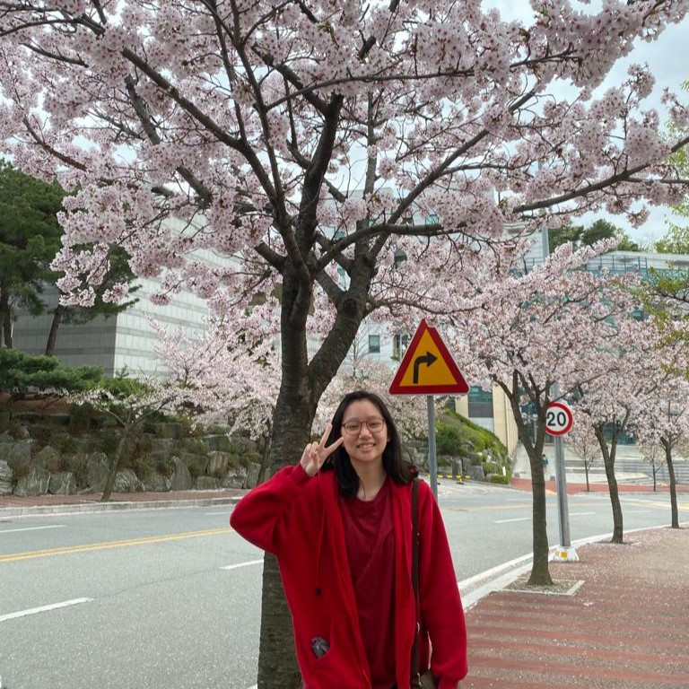

## Hello, My Name is Deby Angelina

I'm a senior at Dankook University and a soon to be software engineer and/or developer, from Semarang, Indonesia. I enjoy debugging and solving complex problems, especially the ecstatic and proud feeling when I finally overcome them. In addition, I'm a resourceful being, one that makes the most of its surrounding, be it people, knowledge, or technology (like google :>); in a positive way.

> When I'm not coding or racking my brain, you'll find me in the virtual world *(aka online games)* or doing art stuff

## Projects

here are some of my note worthy projects from my programming classes:
1. Shopping App - [Compareit](https://github.com/debdeb18/compareit-frontend-react)(JavaScript, React) 
2. Android Game - [Sloppy](https://github.com/debdeb18/sloppy-game)(Java, JNI)
3. MIPS - [Single cycle](https://github.com/debdeb18/MIPS-single-cycle-implementation-in-C), [Pipeline](https://github.com/debdeb18/MIPS-pipeline-implementation-in-C), [Simple Calc](https://github.com/debdeb18/simple-calculator)(C)
4. Program OOP - [Vending Machine](https://github.com/debdeb18/vending-macine-OOP-project)(C++)

## Information

Check out my resume [here](https://drive.google.com/file/d/1ehosL04m51oQFNTltxDc5y1ID40IK3t8/view?usp=sharing)

or reach out to me via

&emsp;

> Winner is your nature, so don't worry about it. Setting your focus on what's naturally yours, will just messed up your tempo    

---

## The 3D portfolio (`index.html`)

A small three.js world, no build step. Open it through any static server (`python3 -m http.server`), or GitHub Pages.

- `src/content.js`: every piece of text. Entries with `todo` are placeholders waiting for real answers.
- `src/worlds/terminal.js`: the platform by the sea, the chair, the train and the dimension crack.
- `src/worlds/home.js`, `office.js`, `market.js`: the three destinations.
- `src/kit.js`: building blocks (rounded boxes, soft materials, clouds, signs, photo frames, the crack, hotspots).
- `src/character.js`: the traveller (jointed limbs, flowing hair and cardigan, walk and sit animation).
- `src/nature.js`: sculpted rocks, twisted trees, swaying grass, flowers, painted ground.
- `photos/`: pictures used in the world. Add a frame with `photo(parent, 'photos/name.jpg', w, h, x, y, z)`.
- `vendor/`: three.js (MIT).

Direct links: `#home`, `#office`, `#market`.

## Blender props (`blender/`)

Props are designed in Blender first, then loaded into the world as `.glb` files.

- `blender/assets/<name>.py`: the design of one prop, as a script.
- `blender/files/<name>.blend`: the same prop as a Blender file you can open and edit by hand.
- `blender/previews/<name>.png`: a render for review.
- `models/<name>.glb`: what the website loads.

Rebuild with `pip install bpy` then `python blender/make.py chair` (or `all`).

## Tests and publishing

`npm install`, then `npm test` opens the site in a headless browser and checks that every world loads with no errors or missing files.
Every push to `main` runs that test and, if it passes, publishes the site to GitHub Pages (`.github/workflows/deploy.yml`).
